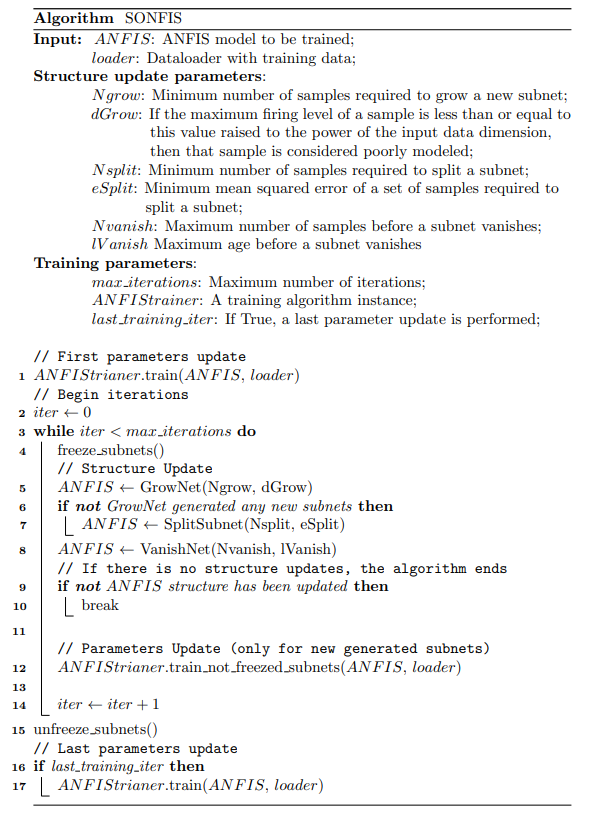

.. _sonfis-usage:

SONFIS
======

Self-Organizing Neuro-Fuzzy Inference System (SONFIS). A structural
adaptation algorithm that combines a parameter learning algorithm with three
operators — GrowNet, SplitNet, and VanishNet — to iteratively update both
the parameters and the rule structure of a rule-reduced ANFIS model.

At each iteration, GrowNet is attempted first: if no new subnets are grown,
SplitNet is attempted. VanishNet is always applied regardless of the
outcomes of the previous operators. The algorithm stops when no structural
updates occur or the maximum number of iterations is reached.

.. warning::
    This algorithm is only applicable to instances of
    :class:`neuro_fuzzy_toolbox.models.rule_reduced_ANFIS`.

.. note::
    - For more details on the SONFIS algorithm, refer to the original paper:
      `SONFIS: Structure Identification and Modeling with a Self-Organizing
      Neuro-Fuzzy Inference System <https://doi.org/10.1080/18756891.2016.1175809>`_.
    - For more details on its implementation in the toolbox, see
      :ref:`SONFIS`.

Instantiation
-------------
The following parameters are available when instantiating the SONFIS
algorithm:

- **Ngrow** (``int``): Minimum number of poorly modeled samples required to
  grow a new subnet.
- **dGrow** (``float``): Threshold for identifying poorly modeled samples. A
  sample is considered poorly modeled if its maximum firing level across all
  subnets is less than or equal to this value raised to the power of the input
  dimensionality.
- **Nsplit** (``int``): Minimum number of samples associated with a subnet for
  it to be considered for splitting.
- **eSplit** (``float``): Minimum loss value of the samples associated with a
  subnet for it to be considered for splitting.
- **Nvanish** (``int``): Number of associated samples below which the age
  counter of a subnet is incremented (it is reset to ``0`` otherwise). With
  ``Nvanish=1``, the age only increases when the subnet has no associated
  samples.
- **lVanish** (``int``): Age at which a subnet is removed: a subnet is
  removed as soon as its age reaches ``lVanish``.
- **max_iterations** (``int``): Maximum number of structural adaptation
  iterations.
- **ANFIStrainer** (``base_model_trainer``): Instantiated training algorithm
  that defines how the model parameters are updated at each iteration. Any
  training algorithm available in Neuro-Fuzzy Toolbox can be used.
- **early_stopping** (``nft.EarlyStopping``): Early stopping mechanism applied
  at the SONFIS iteration level, based on the validation loss. The initial
  model (after its first training) is also a candidate to be restored
  (Default: ``None``).
- **lse_for_new_consequents** (``bool``): If ``True``, the consequent
  parameters of rules generated by GrowNet or SplitNet are initialized
  using least-squares estimation instead of random initialization
  (Default: ``False``).
- **lse_for_new_consequents_lambda** (``float``): Lambda value for Ridge
  regularization in the least-squares initialization of new consequent
  parameters. If ``0.``, no regularization is applied (Default: ``0.``).
- **last_training_iteration** (``bool``): If ``True``, performs a final
  parameter update over all subnets after the SONFIS algorithm finishes
  (Default: ``False``).

Example
#######
First, instantiate the parameter training algorithm to be used inside SONFIS:

.. code-block:: python

    import neuro_fuzzy_toolbox as nft
    import torch
    import torch.nn as nn

    ANFIStrainer = nft.Hybrid_learning_algorithm(
        epochs=500,
        loss_function=nn.MSELoss(),
        optimizer=torch.optim.AdamW,
        optimizer_params={'lr': 1e-4, 'weight_decay': 1e-3},
        early_stopping=nft.EarlyStopping(patience=40, delta=1e-4)
    )

Then, instantiate the SONFIS algorithm:

.. code-block:: python

    sonfis = nft.SONFIS(
        Ngrow=30,
        dGrow=0.8,
        Nsplit=25,
        eSplit=1.2,
        Nvanish=5,
        lVanish=3,
        max_iterations=100,
        ANFIStrainer=ANFIStrainer,
        early_stopping=nft.EarlyStopping(patience=7, delta=0.01),
        last_training_iteration=True
    )

The following arguments are available when calling the algorithm via
``__call__``:

- **ANFISmodel**: Rule-reduced ANFIS model to train.
- **train_loader**: DataLoader with the training data.
- **val_loader**: DataLoader with the validation data (Default: ``None``).
- **verbose**: Whether to print progress and structural update messages at
  each iteration (Default: ``True``).

Assuming ``model`` is an instantiated ``rule_reduced_ANFIS`` model and
``train_loader`` and ``val_loader`` are PyTorch DataLoaders, training is
invoked as follows:

.. code-block:: python

    sonfis(model, train_loader, val_loader, verbose=True)

.. important::
    The early stopping mechanism passed to ``ANFIStrainer`` operates at the
    **parameter update** level within each SONFIS iteration, monitoring the
    validation loss computed on the ``val_loader`` passed to ``__call__``. The
    early stopping mechanism passed directly to SONFIS operates at the
    **iteration** level and monitors the overall validation loss across
    iterations. Both are independent and can be configured separately.

.. note::
    In each iteration, only the subnets that are not frozen are updated. When
    ``Hybrid_learning_algorithm`` is used as ``ANFIStrainer``, the consequent
    parameters of those subnets are estimated by least squares, either on the
    residual left by the frozen subnets (``consequents_estimation='global'``)
    or separately for each subnet (``consequents_estimation='local'``, as in
    the original SONFIS formulation). In both cases, the frozen subnets are
    never modified.

.. important::
    The training batch size is determined by the DataLoader, so this should
    be taken into account when defining it (see
    :ref:`PyTorch DataLoaders <DataLoaders_usage>`).

Reproducing the original formulation
####################################
Several choices of the toolbox differ from the original SONFIS formulation
(Allende-Cid et al., 2016), but each of them is optional. The original
formulation is obtained with the following configuration:

- a ``rule_reduced_ANFIS`` model with a single rule and
  ``nft.Gaussian_MF(sigma_is_std=False)``, the Gaussian form of the original
  paper;
- ``Hybrid_learning_algorithm`` with ``consequents_estimation='local'``
  (weighted least squares for each rule) and
  ``optimizer=nft.NormalizedGradientDescent`` (premise update with a step of
  length :math:`\gamma`), trained with a single batch;
- no early stopping, neither in SONFIS nor in the parameter trainer, and
  ``last_training_iteration=True`` (all the subnets are trained after the
  structure stabilizes).

The values below are those reported for the first synthetic experiment of
the original paper. The step size ``gamma`` and the number of ``epochs`` per
iteration are not reported there, so they must be chosen by the user.

.. code-block:: python

    import neuro_fuzzy_toolbox as nft
    import torch.nn as nn
    from torch.utils.data import TensorDataset, DataLoader

    model = nft.rule_reduced_ANFIS(
        input_size=x_train.shape[1],
        num_mfs=1,
        membership_function=nft.Gaussian_MF(sigma_is_std=False)
    )
    model.init_premises(x_train)

    ANFIStrainer = nft.Hybrid_learning_algorithm(
        epochs=100,
        loss_function=nn.MSELoss(),
        optimizer=nft.NormalizedGradientDescent,
        optimizer_params={'gamma': 0.1},
        consequents_estimation='local'
    )

    sonfis = nft.SONFIS(
        Ngrow=30, dGrow=0.8,
        Nsplit=40, eSplit=0.5,
        Nvanish=30, lVanish=2,
        max_iterations=100,
        ANFIStrainer=ANFIStrainer,
        last_training_iteration=True
    )

    train_loader = DataLoader(TensorDataset(x_train, y_train), batch_size=len(x_train))
    sonfis(model, train_loader)

.. note::
    The original paper describes the age counter of VanishNet as increasing
    when a subnet has no associated samples, which corresponds to
    ``Nvanish=1``, while its reported experiments use larger values of
    ``Nvanish``. With ``Nvanish > 1``, the counter increases whenever the
    subnet has fewer than ``Nvanish`` associated samples.